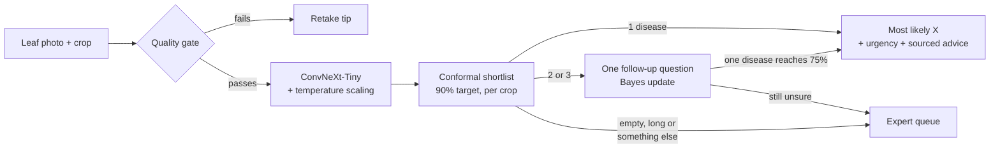

# Crop Doctor

**A tomato and potato leaf-disease assistant that knows when it doesn't know.**
It answers when it is sure, asks the farmer one question when it is almost sure, and sends the photo to a human
expert when it isn't, instead of guessing.

**Live:** [cropdoctor.cv](https://cropdoctor.cv) · **Docs:** [viva notes](docs/viva_notes.md) ·
[project plan](PLAN.md) · [literature review](research/crop-uncertainty/report.md) ·
[model notebook](notebooks/crop_doctor_model.ipynb) · [deployment](docs/DEPLOY.md)

---

## Why

Crop disease models look excellent on lab photos and fail on farms. We measured it before building anything:

| | Lab photos (PlantVillage) | Real field photos (PlantDoc) |
|---|---|---|
| Accuracy | 98.5% | **25.0%** |
| Average confidence | 98.8% | **83.2%** |
| Wrong answers given with > 90% confidence | 10 of 26 | **179 of 357** |

A model that is wrong three times in four while sounding sure is dangerous: a farmer may spray the wrong chemical or
ignore late blight. Crop Doctor is built around one question: **how can an assistant know when it doesn't know, and how
few expert labels does it need to keep that promise on real farms?**

## Results

On **1,306 held-out field photos** (never used for training or calibration):

| | Result |
|---|---|
| First answer right | **87.7%** (PlantDoc 66.8%, Tanzania 99.6%) |
| Shortlist contains the right disease (target 90%) | **90.8%** |
| Average shortlist length | 1.56 diseases |
| Whole assistant: photos answered without an expert | **73.0%**, of which **95.3%** are right |
| Never-seen tomato problems given a confident wrong answer | 53.9% → **20.8%** with a "something else" class |

The headline research finding: calibrated on lab photos, the "90% shortlist" contains the right disease only
**31.7%** of the time on farm photos; about **50 expert-labelled field photos** make the 90% promise dependable.

The Tanzania number is in-distribution (same farms and phones as training). PlantDoc is the independent test; there the
assistant answers fewer photos itself and sends more to experts, which is the intended behaviour. Full results,
caveats and the near-duplicate audit are in [docs/viva_notes.md](docs/viva_notes.md).

## How it works



1. **Quality gate:** blur, brightness, size and leaf checks, with a specific retake tip.
2. **Model:** ConvNeXt-Tiny fine-tuned on lab + field photos; the farmer's crop masks out the other crop's diseases.
3. **Calibration:** temperature scaling fitted on expert-labelled field photos, so "70% sure" means right ~70% of the time.
4. **Conformal prediction:** randomised APS shortlists with one threshold per crop (Mondrian), covering the true
   disease ~90% of the time.
5. **Decision:** answer, ask one visual question, or hand over to an expert.
6. **Advice:** urgency from spread rate and how much of the crop is affected; treatment notes retrieved from sourced
   documents (TNAU, UC IPM, university extension services) and worded by an LLM that can never change the diagnosis.
7. **Live recalibration:** each expert answer to a random audit (10% of answered photos) refits the temperature and
   thresholds immediately.

## Live system

```
phone → Next.js website (Vercel) → FastAPI + ONNX model (Render, CPU) → Postgres (Supabase)
```

- Picture-first interface for farmers, Hindi screens, replies in 8 Indian languages, read-aloud, dark and light themes.
- The server runs the model as ONNX without PyTorch (294 MB RAM on Render's free plan); its answers match PyTorch on
  all 1,306 test photos.
- Expert dashboard: answer queue, random audits, and a live "trust meter" for the 90% promise.

## Quick start

Windows, Python 3.13, Node 20+.

```bash
py -3.13 -m venv .venv
.venv/Scripts/python -m pip install -r requirements.txt
.venv/Scripts/python -m pytest -q                                # 141 tests
```

Run the app locally:

```bash
.venv/Scripts/python -m uvicorn server.main:app --port 8000      # API on http://localhost:8000/docs
npm --prefix web install
npm --prefix web run dev                                          # website on http://localhost:3000
```

Or try one photo from the command line:

```bash
.venv/Scripts/python -m crop_doctor.assistant.pipeline path/to/leaf.jpg --crop tomato
```

Deployment (Vercel, Render, Supabase) is described in [docs/DEPLOY.md](docs/DEPLOY.md).

## Reproduce the experiments

Datasets (~1.7 GB) download into `datasets/` (git-ignored). Each experiment writes figures to
`crop_doctor/outputs/figures/` and numbers to `crop_doctor/outputs/metrics/`.

| Step | Command (`python -m …`) | What it shows |
|---|---|---|
| Data | `crop_doctor.data.download`, `crop_doctor.data.prepare` | clean, de-duplicated, stratified splits |
| Lab model | `crop_doctor.model.train`, `crop_doctor.model.export_logits` | the 98.5% → 25.0% lab-to-field gap |
| Exp 1–3 | `crop_doctor.experiments.exp1_shift` / `exp2_calibration` / `exp3_selective` | shift, calibration, answer-only-when-sure |
| Exp 4 | `crop_doctor.experiments.exp4_expert_budget` | how many expert labels keep the 90% promise |
| Exp 5 | `crop_doctor.model.train_final`, `crop_doctor.experiments.exp5_final_model` | a stronger field model |
| Exp 6 | `crop_doctor.experiments.exp6_pipeline` | the whole assistant with simulated farmers |
| Exp 7 | `crop_doctor.experiments.exp7_retrieval` | advice retrieval quality |
| Exp 8 | `crop_doctor.model.train_v2`, `crop_doctor.experiments.exp8_final_v2` | more field data (v2 model) |
| Exp 9 | `crop_doctor.experiments.exp9_unfamiliar` | can confidence spot unknown diseases? (no) |
| Exp 10 | `crop_doctor.model.train_v2 --splits splits_v3 --tag final_v3_convnext_tiny`, `crop_doctor.experiments.exp10_something_else` | a "something else" class |
| Exp 11 | `crop_doctor.experiments.exp11_label_strategy` | uncertainty-picked vs random expert labels |
| Exp 12 | `crop_doctor.model.train_leaves` ([Colab notebook](notebooks/exp12_leaf_crops_colab.ipynb)) | train on PlantDoc leaf cut-outs: PlantDoc 63.7% → 66.8%; the app's model since Exp 12 |
| Audit | `crop_doctor.data.near_duplicates` | resized or rotated twins across splits |
| Ship | `crop_doctor.model.export_onnx` | package the model for the server |

Exp 4 and Exp 11 accept `--smoke` for a quick check; Exp 4's full run takes about 20 minutes on an RTX 3050.

## Data

| Source | Licence | Used for |
|---|---|---|
| [PlantVillage](https://arxiv.org/abs/1511.08060) (lab photos) | public research dataset | training |
| [PlantDoc](https://arxiv.org/abs/1911.10317) (field and web photos) | public research dataset | training, calibration, independent test |
| [Tanzania Irish Potato](https://zenodo.org/records/8286529) (smallholder farm photos) | CC BY 4.0 | training, calibration, test |
| Tomato-Village (Gehlot et al., 2023) | none stated | training only, unknown-problem probe |

Every source was inspected before use: Tanzania was de-duplicated before splitting (one photo appears 350 times), and
two advertised field datasets were rejected after inspection (see the viva notes, Day 1 and Day 9).

## Repository layout

```
crop_doctor/
  data/           download, cleaning, splits, near-duplicate audit
  model/          training, crop-aware prediction, ONNX export
  uncertainty/    calibration, selective prediction, conformal prediction, active learning
  assistant/      decision rules, pipeline, LLM replies, live recalibration
  knowledge/      sourced treatment notes + retrieval (RAG)
  vision_extras/  photo quality gate, rough severity estimate
  experiments/    exp1 … exp11, one script each
  app/            Streamlit research demo + shared service layer
server/           FastAPI API used by the website
web/              Next.js website
tests/            pytest suite
notebooks/        the model from dataset to evaluation
docs/             viva notes, deployment guide
research/         literature review
```

## Limitations

- Nothing was trained or calibrated on the test set, but it was reused for reporting across versions; a fresh test
  set is the next step.
- The 90% promise is an average over the calibration mix, not per disease; a one-disease answer is right ~77–79% of
  the time, so the app always says "most likely" and recommends expert confirmation before spraying.
- Expert labels and farmer answers are simulated in the experiments; a pilot with real farmers is future work.
- Treatment notes should be reviewed by an agriculture expert before real use.

Crop Doctor is a student project. Always confirm a diagnosis with a local agriculture officer or KVK before spraying.
